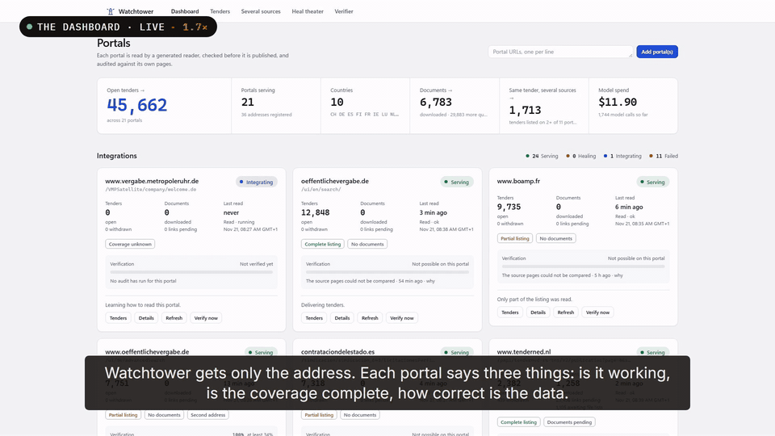
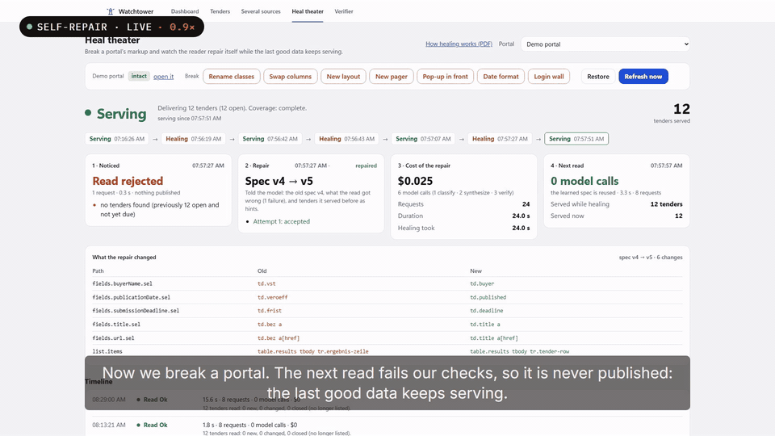
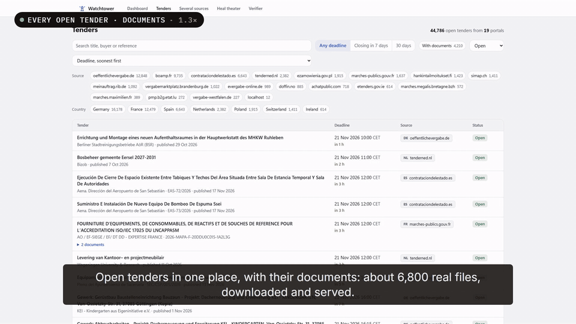
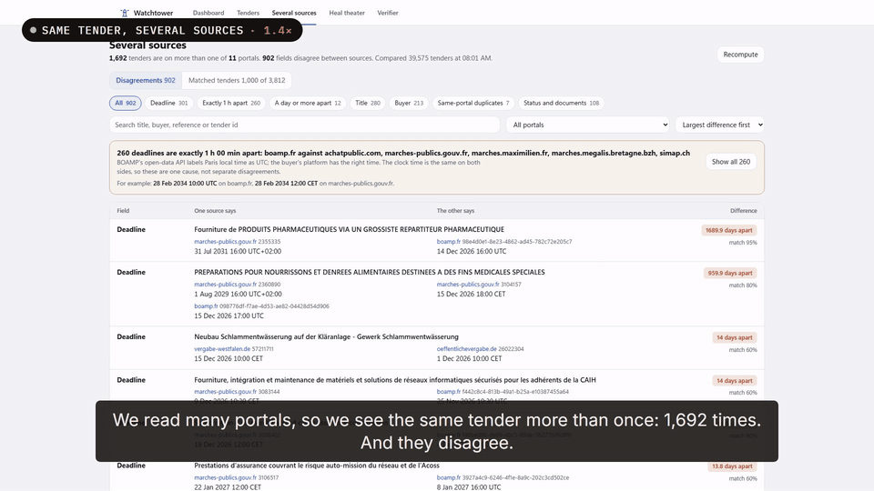
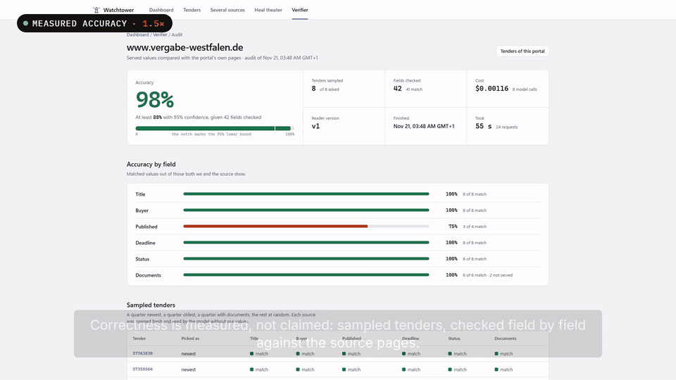
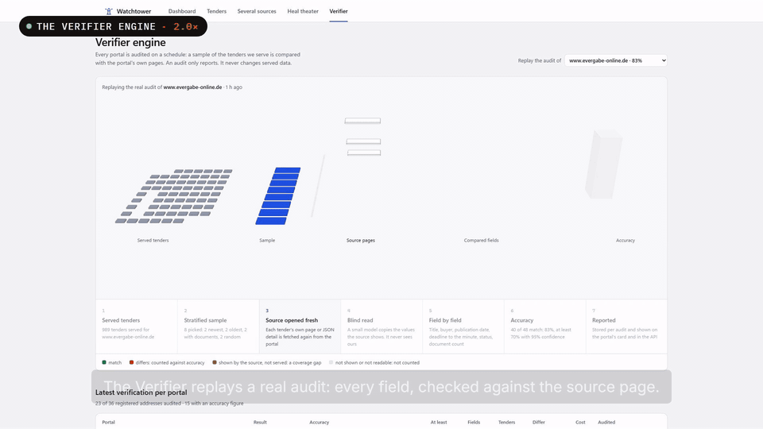

<h1 align="center">Watchtower</h1>

<p align="center"><b>Give it a procurement portal's address. It learns to read the portal, serves its open tenders and documents, notices when the portal changes, and repairs itself.</b></p>

<p align="center">
  
</p>

<p align="center">
  <a href="#how-it-works">How it works</a> ·
  <a href="#run-it">Run it</a> ·
  <a href="#measured-results">Measured results</a> ·
  <a href="#known-limits">Known limits</a>
</p>

<p align="center">
  20 portals in 10 countries, about 45,700 open tenders (21 Nov, 08:55 CET) ·
  blind attach: 5 of 15 on the first try, 6 of 15 counting an automatic retry ·
  a read that fails the checks is never published ·
  repair in 23–46 s in the filmed runs ·
  <a href="#known-limits">known limits</a>
</p>

<sub>The clips are cut from the demo video, filmed at 08:44 CET, so a few on-screen figures differ slightly from the 08:55 numbers in this README. The dashboard also lists the built-in demo portal as a 21st card.</sub>

## See it work

**Self-repair.** A portal's markup is broken on purpose: the next read is rejected, the last good data keeps serving, the model repairs the reader and shows what changed, and the following read makes 0 model calls. (Clip sped up 3×; this repair took 46 s.)



**Tenders, with their documents.** Open tenders from every portal in one list, filtered to those with documents, with one tender's files opened.



**Same tender, several sources.** Tenders served by more than one portal are matched, and where the sources disagree (here, deadlines) both values are shown. (Clip sped up 2×.)



**Measured correctness.** One portal's audit: sampled tenders, compared field by field with the source pages.



**The Verifier.** A replay of a real audit, step by step: sample, open the source pages, read blind, compare each field.



## Run it

1. Copy `.env.example` to `.env` and add your OpenAI key.
2. `docker build -t watchtower .`
3. `docker run -p 8080:8080 --env-file .env -v watchtower-data:/data watchtower`
4. Open http://localhost:8080.
5. The fastest proof: **Heal theater** → **Attach demo portal** → **Rename classes**.
6. A fresh install starts empty: add portal URLs on the dashboard.

---

An agent that attaches to European public-procurement portals from their address alone, serves their open tenders and documents, notices when a portal stops delivering correctly, and repairs itself.

> **Live on 20 European portals in 10 countries, ≈ 45,700 open tenders** (21 Nov 2026, 08:55 CET): oeffentlichevergabe.de, BOAMP, PLACSP (via its official ATOM feed), TenderNed, e‑Zamówienia, PLACE, vergabemarktplatz Brandenburg, simap.ch, Hilma (FI), RIB, evergabe‑online, Doffin (NO), achatpublic, eTenders (IE), Mégalis Bretagne, Maximilien, PMP Luxembourg, vergabe‑westfalen, Alsace Marchés Publics, Vergabemarktplatz Rheinland‑Pfalz (partly). Every one was attached from its address; six of them in **blind runs** on 21 Nov (below); regular reads make **no model call**. Each portal reports **integration health** (its state) separately from **data coverage** (`coverage`: complete / partial, with the reason) and from **measured correctness** (`verification`: sampled audits against the source pages). Two extras: a **heal theater** (`/_ui/heal`) that breaks a built-in demo portal on demand and shows the detection, the repair, the spec diff and the cached read; and **"same tender, several sources"** (`/_ui/crossref/view`), which finds tenders served by more than one portal and shows who says what when they disagree.

## How it works
**Compile, don't interpret.** When a portal is attached, an LLM learns how to read it and writes a declarative **spec** (where the list is, the pagination, the field mapping, the document steps). Regular reads run that spec with a static runner and **make no model call**. The LLM comes back only to verify, audit or repair.

- **Attach:** `POST /portals` → `integrating` → the Onboarder learns a spec → dry run → blind verify → full read → commit → `serving`.
- **Notice:** every read is staged and checked (completeness, field profiles, unchanging-field drift, and block markers). It's committed only if every check passes, so the state we report always matches what we serve.
- **Repair:** a rejected read → `healing` (the last correct snapshot keeps being served) → re-learn the spec, seeded with the old one → accepted only with enough evidence → `serving`. Otherwise `failed`, with the reason in words.
- **Politeness:** one shared per-host limiter, ≤ 1 request/second (`WATCHTOWER_MIN_REQUEST_INTERVAL`, default 1.05 s). Every redirect hop counts as a request. Each job has a request budget.

## Run
```bash
docker build -t watchtower .
docker run --rm -p 8080:8080 --env-file .env -v watchtower-data:/data watchtower
# dashboard: http://localhost:8080/
```
Heal demo (in the same container; `WATCHTOWER_DEMO=1` is the default, `0` turns it off): open `http://localhost:8080/_ui/heal`, press **Attach demo portal** (the mock portal served at `/_demo/portal/`), wait for *Serving*, press a **Break** button (e.g. *Rename classes* or *Swap columns*), watch it heal, then **Refresh now** for the cached read (0 model calls). Timeline data: `GET /_ui/events?portal=&since=`.

Local dev without Docker:
```bash
pip install -r requirements-dev.txt
WATCHTOWER_DATA_DIR=./data uvicorn watchtower.api:create_app --factory --port 8080
pytest -q
# play with the mock portal:
uvicorn mock_portal.app:app --port 9000      # then POST http://localhost:8080/portals {"url": "http://localhost:9000/"}
# break it:  curl -X POST localhost:9000/_admin/config -H "content-type: application/json" -d '{"mutations":["swap_columns"]}'
```

## Environment variables
| Variable | Purpose |
|---|---|
| `OPENAI_API_KEY` | Model key (the value is handed over at hand-in, never committed) |
| `OPENAI_BASE_URL` | Optional; default `https://api.openai.com/v1` |
| `MODEL_STRONG`, `MODEL_CHEAP` | Model per tier. Strong: synthesize/repair. Cheap: classify/verify/audit/triage |
| `MODEL_<TASK>` | Optional override for one task (e.g. `MODEL_VERIFY`), so models can be mixed per feature |
| `MODEL_REASONING_STRONG`, `MODEL_REASONING_CHEAP`, `MODEL_REASONING_<TASK>` | Reasoning effort per tier/task (defaults: low / none). Dropped automatically if a model rejects it |
| `PRICE_IN_<MODEL>`, `PRICE_OUT_<MODEL>` | USD per 1M tokens, for the cost ledger |
| `LLM_CONCURRENCY` | Number of parallel model calls (default 4) |
| `WATCHTOWER_SERVE_CAPPED` | Default `1` (agreed with Patterno): a working read of a listing the portal caps (e.g. a 10,000-result window) serves, with `coverage.tenders = "partial"` and the reason. `0` = such a portal is `failed` |
| `WATCHTOWER_RESPECT_ROBOTS` | `1` = obey each site's robots.txt (RFC 9309, cached 6 h; disallowed documents are reported as unavailable). Default `0` (team decision for the hackathon) |
| `WATCHTOWER_USER_AGENT` | Default `Watchtower/0.1 (+hackathon; automated tender monitor; polite 1 req/s)` — says it is automated, without the token "bot" (some servers give `/bot/i` clients no session) |
| `WATCHTOWER_HOST_INTERVALS` | Slower per-host spacing as data, `host=seconds,…` (default `ezamowienia.gov.pl=2.1`, its published 30 req/min). A host that answers HTTP 429 is slowed down automatically (Retry-After honoured) |
| `WATCHTOWER_DEMO` | `1` (default) mounts the demo portal at `/_demo/portal/` for the heal theater; `0` turns it off |
| `WATCHTOWER_PUBLISHED_WINDOW_DAYS` | For lists sorted by publication date: stop once a whole page is closed and older than this (default 365) |
| `WATCHTOWER_FEED_BACKFILL_DAYS` | Change feeds (ATOM/RSS, list kind `feed`): how far back the first load reads (default 30 days; per spec `list.pagination.backfill_days`) |
| `WATCHTOWER_FEED_MAX_FILES` | Change feeds: feed files read per refresh (default 20); an unfinished backfill continues on the next refreshes |
| `MODEL_MAX_CALLS_PER_JOB` | Model-call budget per attach or repair job (default 20) |
| `WATCHTOWER_REFRESH_INTERVAL` | Seconds between background refreshes (default 900; 0 = off) |
| `WATCHTOWER_DATA_DIR` | Data directory (default `/data`) |
| `WATCHTOWER_AUDIT_INTERVAL` | Seconds between verification audits per serving portal (default 21600 = 6 h; 0 = on demand only). A new spec version (after a repair) is audited at the next check |
| `WATCHTOWER_AUDIT_SAMPLE` | Tenders sampled per audit (default 8) |
| `WATCHTOWER_AUDIT_RENDERS` | Browser renders per audit for tender pages that only render with JavaScript (default 4) |
| `WATCHTOWER_AUDIT_REQUEST_BUDGET` | Request budget per audit (default 250, including the requests a browser render makes) |
| `WATCHTOWER_AUDIT_DEGRADED_BELOW` | Accuracy under which an audit reports `degraded` (default 0.9) |

## API (per the brief)
`POST /portals` · `GET /portals` · `GET /portals/{id}` · `DELETE /portals/{id}` · `POST /portals/{id}/refresh` · `GET /portals/{id}/tenders[?changedSince=]` · `GET /portals/{id}/runs` · `GET /files/{sha256}` · `GET /` (dashboard). Agreed with Patterno: fields may be added. Portal entries carry `coverage` (`tenders`: complete/partial, `details.pending`, `documents`: available/pending/partial/unavailable/none, `reasons`) and `verification` (see below); a tender whose documents sit behind a login carries `documentsUnavailable` with the reason. Dashboard-only extras live under `/_ui/…` (`/_ui/heal`, `/_ui/events`, `/_ui/crossref`, `/_ui/audit/{id}`).

**One tender per procedure** (agreed with Patterno): notices of one procedure (original, corrections, cancellation) are merged; the newest notice's values win and a cancellation sticks. **Open** = the portal's own open/current view: a call for competition with a deadline ahead. A notice whose type or phase (`fields.noticeType`: a column, label, badge or JSON field the portal shows; without one, a procedure type such as "Ex post") says award, result, ex-post publication or prior information only is not served as open, in German, French, Dutch, Spanish, Italian, Polish and English (vergeben, Zuschlag, attribution, gunning, adjudicación, aggiudicazione, udzielenie …); a cancellation (Aufhebung, annulation, unieważnienie …) is `withdrawn`. A tender already served whose newest notice is an award is served as `closed`. When most tenders of a read show a deadline, a new one whose list row or tender page shows none is not served; where tender pages showed award notices, a notice whose page is not read yet waits (`stats.heldBack`). A tender missing from a complete read is closed only after **two** complete reads in a row miss it (or when its deadline passes), so one odd read never closes real open tenders. Change feeds (ATOM/RSS) are read as deltas after the first fill; they never close a tender just because a delta did not mention it.

## Same tender, several sources (`/_ui/crossref/view`)
Tenders that more than one portal serves are matched by evidence, strongest first: one record links to another portal's tender, the same reference number (confirmed by buyer or title), or a near-identical title with a matching buyer and the same deadline minute. Lots are never merged. For each match, every source's value is shown with its link, and disagreements are listed first (deadline, then status, buyer, title). Live on 21 Nov, 07:40 (14 portals): **1,542 tenders served by more than one portal, across 10 portals**, with **271 deadline disagreements**. **231 of them are exactly one hour apart**: BOAMP's open-data API labels the local time as UTC on those notices, while the buyers' own platforms (PLACE, Maximilien) give the right time — an aggregator relying on the API alone would publish them an hour off. 12 differ by a day or more, mostly the federal registry (oeffentlichevergabe) still holding an older version of a notice from a regional platform (vergabe‑westfalen, Brandenburg), e.g. 4 Dec 09:00 vs 1 Dec 09:00 — checked by hand on two. Title and buyer differences (279 / 119) are mostly formatting and truncation.

## Verification: how correct is what we deliver?
Attach-time blind verification checks about 3 tenders, once. `watchtower/audit.py` measures again on a schedule, for every serving portal, and reports an accuracy figure per portal.

**What one audit does.** It samples K served tenders (default 8): a quarter newest, a quarter oldest by publication date, a quarter with documents, and the rest at random. It opens each tender's source: the JSON detail when the spec reads one, otherwise the tender page. Pages that only render with JavaScript go through the same bounded browser path as attach. The cheap model then copies what the source shows **without seeing our values**, using blind verification's prompt plus status and document count. The audit compares field by field:

| Field | Counts as a match when |
|---|---|
| title, buyer | the values are equal after normalising case, spaces and punctuation, one contains the other (at least 8 characters), or they are ≥ 90 % similar. Any other buyer name the page gives also counts |
| publicationDate | the calendar date is the same |
| submissionDeadline | the instant is the same to the minute. An offset on the page is used; otherwise the portal's timezone applies, including notes like "(heure de Paris)" or "Ortszeit". A page that shows only the date is compared by date |
| status | the page says open, withdrawn or closed/awarded, and that agrees with our derived status |
| documents | we serve at least as many files as the page lists. We may serve more, because ZIP files are unpacked. A shortfall is not counted while our downloads for that tender are still pending |

**Accuracy** = matched / checked. A value is checked when we deliver it *and* the source shows it. When the source shows a value that we serve as null, it is counted as `missing`, which is a coverage gap rather than a wrong value. Values in a format the audit cannot read, or with downloads still pending, are listed but not counted. `accuracyLow95` is the lower bound of the 95 % Wilson interval. Status is `ok` (≥ 0.9, `WATCHTOWER_AUDIT_DEGRADED_BELOW`), `degraded`, or `not possible: <why>` when no sampled source could be read (for example HTTP 403, or JavaScript-only pages with no render left). **An audit only reports.** It never changes served data, the spec or the portal state, and it does not trigger a repair, because a noisy model reading must not rewrite good data.

**Where to see it.**
- Every contract portal entry carries `verification`: `{"lastAuditAt", "sampled", "fieldsChecked", "fieldsMatched", "accuracy", "accuracyLow95", "byField": {field: {checked, matched, missing}}, "mismatches", "costUsd", "status"}`. Before the first audit, `status` is `"pending"`.
- `GET /_ui/audit/{id}` returns the latest audit in full. Every disagreement is listed with the page value, our value and the tender URL, alongside the audit history. `POST /_ui/audit/{id}` runs an audit now; the dashboard's **Verify now** button calls it.
- Results are stored per audit in the `audits` table.

**How often and what it costs.** An audit runs every `WATCHTOWER_AUDIT_INTERVAL` (6 h) per serving portal, one portal at a time. A new spec version, for example after a repair, is audited at the next check. On demand, use the endpoint above. Each audit makes one cheap-model call per tender (about $0.0002–0.0004 each, so **about $0.002–0.004 per audit**) and sends K requests to the portal through the same paced client (≤ 1 request/s per host). A JavaScript render costs more requests, which is why renders are capped (`WATCHTOWER_AUDIT_RENDERS`). At 4 audits a day across 10 portals, that is about $0.15 a day.

**Limits.** 8 tenders give about 40 field comparisons. That is enough to tell 95 % from 70 %, but not 99 % from 97 %: 40/40 still only shows ≥ 91 % with 95 % confidence. History accumulates in `/_ui/audit/{id}` for a tighter figure. The model is the reference, so a model misreading counts as our error; mismatches are listed so that a person can check them. Document count is the weakest check, because the model counts links. JavaScript-only tender pages depend on the browser render (4 per audit by default). For change feeds, the audit compares the page the entry links to, not the feed entry itself.

**Live audits · 21 November 2026, ~00:50 CET.** These ran read-only against the live API (`GET /portals/{id}/tenders`), comparing against the tender pages a person would open. K = 10, seed 7 (`python -m watchtower.audit --k 10 --seed 7 <portal ids>`):

| Portal | Matched / checked | Accuracy (95 % low) | What disagreed | Cost · requests |
|---|---|---|---|---|
| TenderNed (JSON API; compared against the rendered website pages, 9 of 10 rendered) | 42/43 | **97.7 %** (88 %) | 1 status: the page says closed, we serve withdrawn | $0.0012 · 134 |
| marches.maximilien.fr | 52/56 | **92.9 %** (83 %) | 2 publication dates (the page's online date 06/11 against our 10/11), 2 document counts | $0.0021 · 10 |
| marches-publics.gouv.fr | 34/37 | **91.9 %** (79 %) | Tender 1904703 is served as open without a deadline, but the page shows 11/11/2025 and closed. 2 document counts. 4 buyer and 4 deadline values are missing | $0.0026 · 10 |
| evergabe-online.de | 39/43 | **90.7 %** (78 %) | 4 document counts: the page lists 2–4 files, we serve 1. 4 tenders are served without buyer, dates or deadline (missing) | $0.0037 · 21 |
| oeffentlichevergabe.de (JavaScript app: 6 of 10 pages rendered, request budget reached) | 9/10 | **90 %** (60 %) | 1 publication date (16 May against our 13 May) | $0.0008 · 251 |
| vergabe-westfalen.de | 31/38 | **81.6 %** (67 %) · `degraded` | 7 of 10 sampled notices are ex-post award notices ("Auftrag bereits vergeben"), but we serve them as open | $0.0011 · 30 |

Six audits cost **$0.011** in total. The TenderNed and oeffentlichevergabe rows were re-scored with the final comparator, which adds Dutch month abbreviations and US dates, using the values the model copied in that run. marches-publics was re-run after the "(heure de Paris)" fix. Two findings are real data problems, not audit noise: vergabe-westfalen serves award notices as open tenders (checked by hand on pid 57362887), and marches-publics serves a tender closed in 2025 as open.

**Fixed (award notices).** Re-attached in a fresh container with the notice-type rule, vergabe-westfalen reads the same 1,038-row listing and maps its "Typ" column ("Ausschreibung" / "Vergebener Auftrag" / "Beabsichtigte Ausschreibung") as `noticeType`: 794 notices are recognised as awards or prior information and 17 more show no deadline, so **227 are served**. That is the count the portal's own extended search states for its open tenders ("Gesamteinträge: 227"). Audit (K = 10, seed 7): **52/54 = 96.3 %, `ok`**, status 10/10 and deadlines 10/10. Before the fix, the same audit on the served data scored 35/42 = 83.3 % with status 3/10. evergabe-online, which was fine before, is unchanged by the rule: 977 of 979 listed are served, the 2 others have no deadline on their tender page (238 of the 240 pages read have one), with 0 notices held back. The audit now also counts a page whose deadline has passed as closed, which flags one stale evergabe-online tender that is still waiting for its tender page to be read.

The in-app job was tested in its own container: attach TenderNed, then run `POST /_ui/audit/{id}`. With the default settings (K = 8, 4 renders), the audit compared 3 rendered pages and matched **14/14 fields**, using 104 requests and costing $0.0004. The rest were skipped as "renders only with JavaScript (no browser render left)". TenderNed's spec reads no JSON detail, so its tender pages are the source.

<a name="measured-results"></a>
## Measured results · 21 November 2026, ~08:55 CET

**Live portals** (attached from their address; counts = open tenders served, one per procedure):

| Portal | Tenders | Coverage | How it is read |
|---|---|---|---|
| oeffentlichevergabe.de (DE, federal registry) | 12,864 | complete | POST search API found in the browser; 18,629 notices read from both ends of a 10,000-result window |
| BOAMP (FR, national journal) | 9,735 | partial (result window) | its official open-data records API, open filter `datelimitereponse >= today` found by evidence |
| TenderNed (NL) | 2,829 | complete | public JSON API; open filter `sluitingsDatumVanaf={today}` found by evidence; documents per notice |
| e‑Zamówienia (PL) | 1,914 | partial (page cap) | JS app search; 2.1 s spacing (published 30 req/min limit) |
| PLACSP (ES) | 7,324 | partial (feed backfill running) | official ATOM syndication feed, delta reads (website behind a WAF) |
| PLACE / marches-publics.gouv.fr (FR) | 1,641 | complete | Atexo, PRADO postback pager |
| vergabemarktplatz Brandenburg (DE) | 1,587 | complete | cosinex; public company area (the root redirects to the buyers' login) |
| Hilma (FI) · blind run | 1,423 | complete (see the placeholder-id limit below) | public JSON search found behind the JavaScript app; **attached in 4 min 36 s for $0.033** |
| RIB meinauftrag (DE) | 1,092 | complete | infinite scroll (load-more XHR) |
| evergabe-online (DE, federal) | 989 | complete | Wicket; session cookie + Referer |
| simap.ch (CH) | 1,454 | partial (tender details still filling in) | cursor-paged JSON API; deadline from a per-tender JSON record found by evidence |
| achatpublic (FR) | 718 | complete | hidden-form pager |
| eTenders (IE) | 614 | complete | HTML search form; open filter (deadline from today) found by evidence |
| Mégalis Bretagne (FR) · blind run | 572 | partial (1 row without a readable link) | Atexo, form-post pager; 19 min, $0.125 |
| Maximilien (FR) | 389 | partial (13 rows link out to another platform without a readable link) | Atexo |
| PMP Luxembourg (LU) · blind run | 273 | complete | Atexo, form-post pager; 21 min, $0.118 |
| Doffin (NO) · blind run, automatic retry | 889 | complete | refused on the first try (POST JSON search), learned on Watchtower's own retry |
| Alsace Marchés Publics (FR) · blind run | 187 | complete | Atexo; 13 min, $0.121 |
| Vergabemarktplatz Rheinland-Pfalz (DE) · blind run | 11 | **partial in fact** (reads the welcome page's 20 latest notices; see known limits) | cosinex |
| vergabe-westfalen (DE) | 227 | complete — 748 award / result / prior-information notices in the same listing are not served as open | cosinex; deadline by column header + tender-page label; notice type |

| Check | Result |
|---|---|
| Hand checks against the websites | TenderNed **5/5**, oeffentlichevergabe **6/6**, PLACE 2/5 at the time (buyer/deadline come from tender pages, then still filling in); notes in `watchtower-team/manual-check/` |
| Measured accuracy (in-app audits, K=8, 21 Nov 07:00) | vergabe‑westfalen **97.6 %** (81.6 % before the notice-type rule), eTenders 94.9 %, Maximilien 93.0 %, PLACE 91.9 %, simap 90–100 %, evergabe‑online 87.5 %, achatpublic 80.6 %, oeffentlichevergabe 100 % (3 rendered pages). TenderNed 97.7 % in the read-only audit. BOAMP, RIB and PLACSP: *not possible* — their sources (API record, JavaScript page, WAF-protected page) show nothing the audit can read, and the field says so |
| Blind attach runs (21 Nov, 07:24 / 07:55 / 08:27 CET) | 15 portals never seen before, given only their address. **Run 1: 3 of 5 on the first try** (Hilma FI in 4 min 36 s for $0.033, Mégalis Bretagne, PMP Luxembourg), plus Doffin (NO) on an automatic retry. **Run 2: 0 of 5** (Malta, Wales, Bulgaria, Portugal, Lithuania: each refused with its reason; the blind check caught a wrong title on Lithuania). **Run 3: 2 of 5** (Alsace in full; Rheinland-Pfalz only partly). No wrong data published; $2.92 for all 15. Evidence: `watchtower-team/manual-check/blind-attach-2026-11-21/` |
| Self-healing in production | Spain's ATOM feed was rejected and repaired 14 times overnight: the drift check counted amended notices as a broken reader. No wrong data was published (1,901 kept serving; $0.40). Fixed for change feeds; the next live read passed with no repair and the backfill moved on to 5,425 |
| Self-healing (demo portal) | renamed classes → read rejected, last good 12 tenders kept serving → repair spec v1→v2 in **23 s for $0.023** → next read **0 model calls, 1.9 s**; swapped columns (same shape) also caught and healed |
| Model spend | **$12.48 for the whole run** on the live system (1,803 calls incl. every failed attempt, the three blind runs and all audits); a typical attach ≈ $0.02–0.13; regular reads $0; an audit ≈ $0.002–0.004 |
| Documents | **6,769 real files served** (8,576 document entries), filling in on every refresh (240 per read, newest tenders first). Our own check on 21 Nov found 3,503 'documents' that were web pages (mostly the platforms' own HTML pages); a link that opens a page is now not a document, and those tenders say so. Browse and download them on the Tenders page (`/_ui/tenders/view?docs=1`) |
| Tests | **413 passing** (`sh bench/test.sh`; live regression `python bench/regress.py` against `bench/live-baseline.json`) |
| Clean build | `docker build --no-cache --platform linux/amd64` from the repo: OK (≈ 2.0 GB incl. Chromium); without a key the container serves and fails attaches with "no model configured" |

<a name="known-limits"></a>
**Known limits (honest).**
- Award notices are recognised by the notice type the portal shows, or by a procedure type that says "Ex post". A portal that marks an award only in running text ("dieser Auftrag wurde bereits vergeben") is caught only by the no-deadline rule and by the audit's status check. A spec learned before this rule has no `noticeType`: such a portal needs a re-attach, unless its procedure type names the result publication. The no-deadline rule never removes a tender that is already served.
- BOAMP deadlines come from its open-data API (`datelimitereponse`). Checked on 3 notices (21 Nov) against the notice's own data (`donnees`, `TenderSubmissionDeadlinePeriod`): 2 are the true UTC instant (12:00+01:00 → 11:00Z; 12:00+02:00 → 10:00Z), 1 is the local time labelled +00:00 (notice 11:00:00.000+01:00 → API 11:00Z, one hour late). The error is per notice, not systematic, so no time-zone correction is applied; the fix is to read the deadline from `donnees`.
- Not yet live: Find a Tender (spec verified with its OCDS API, the full read is rate-limited by the portal: retried at 6 s spacing), Contracts Finder (tender pages answer HTTP 403 to automated clients), Doffin (POST JSON search not learned), marchés‑sécurisés (the app needs a session token), marches‑publics.info.
- Rheinland-Pfalz: the locate walk preferred the welcome page's "latest notices" table (20 rows, one page, no stated total) over the search list, and coverage then says complete. A single page with no stated total should not count as complete; next step: report such reads as coverage unknown.
- Région Grand Est was refused by a false blind-check result (it judged '11h00' as no time). Doffin and others retry on their own; Grand Est may too.
- The Tenders page total includes the built-in demo portal's 12 tenders.
- Hilma (FI): 132 open notices carry the placeholder procedure id 0 and are merged into one tender, so about 1,554 tenders are served as 1,423 (found by an outside check against Hilma's own search API). Next step: treat an id that many unrelated notices share as a placeholder, as a general rule. No other portal has a placeholder-looking id.
- In-app audits of TenderNed and e‑Zamówienia report *not possible*: their tender pages need ~90 script files at 1 request/s, and the audit's first browser render hits its 45 s cap on a cold per-job script cache. (TenderNed measured 97.7 % in the read-only audit.) Next step: share the script cache across jobs and give a cold first render more time.
- Cross-portal deadlines: 231 BOAMP deadlines are exactly one hour off against the buyers' own platforms (the API labels local time as UTC on those notices). They are shown with both values, not corrected automatically.
- Terms to discuss with Patterno before production use: eTenders IE restricts scraping for onward transmission; PLACE requires authorisation for reproduction; marchés‑sécurisés requires approval for automated dossier downloads. robots.txt enforcement is built but off by default.

---

## Code map: who builds what
| File | What | Status |
|---|---|---|
| `watchtower/api.py` | HTTP contract + dashboard routes | ✅ done |
| `watchtower/worker.py` | Job manager + state machine (coalescing, healing, failed, backoff, delete) | ✅ done |
| `watchtower/store.py` | SQLite; `commit_snapshot` (lastChangedAt, closing rules, partial reads), served view | ✅ done |
| `watchtower/http.py` | `HostRateLimiter`, `PoliteClient` (budget, manual redirects), `DocumentStore` (stream, sha256, ZIP) | ✅ done |
| `watchtower/llm.py` | Task-routed model calls, parallel `gather`, cost ledger | ✅ live ledger |
| `watchtower/pipeline.py` | Interface: `attach`, `read`, `validate`, `repair` | ✅ |
| `watchtower/engine.py` | The real pipeline (glues the modules below) | ✅ |
| `watchtower/onboard.py` | LLM: locate the list → write the spec (list + detail) → dry run → blind verify, with feedback loops | ✅ (mock) |
| `watchtower/locate.py` | The walk to the tender list: best-first search with backtracking (model top-3 links + multilingual link words, sitemap, GET search forms), a list only with evidence (rows with link + date, tender-like JSON), ranked candidates for `learn()`; budgets 15 pages / 12 classify / 3 renders | ✅ |
| `watchtower/runner.py` | Static reads from a spec; incremental details and documents; block detection | ✅ (mock) |
| `watchtower/extract.py` | Selectors/JMESPath, multilingual date parsing, CPV, procedure and nature keywords | ✅ |
| `watchtower/validate.py` | Notice checks + field profiles (same-shape drift) + repair evidence | ✅ |
| `mock_portal/app.py` | Test portal: `html`/`api` skins, 10 mutations, request log | ✅ |
| Playwright discovery | Finds public JSON feeds in JavaScript apps, during attach and repair | ✅ |
| `watchtower/audit.py` | Continuous verification: sampled audits of served values against the portal (see "Verification") | ✅ |
| `watchtower/crossref.py` | Same tender on several portals: evidence-ranked matching, disagreements with each source | ✅ |
| `watchtower/feed.py` | ATOM/RSS change feeds: backfill, high-water mark, conditional delta reads | ✅ |
| `watchtower/postback.py`, `watchtower/jspager.py` | Pagers that post forms (PRADO, ASP.NET), script-built addresses, form pagers, load-more XHR | ✅ |
| `watchtower/demo.py`, `watchtower/events.py`, `heal.html` | Heal theater: demo portal in the container, break/restore controls, events timeline | ✅ |
| `bench/` | `test.sh` (suite; flaky vs failing), `regress.py` (live regression), `locate_bench.py` (walk benchmark) | ✅ |
